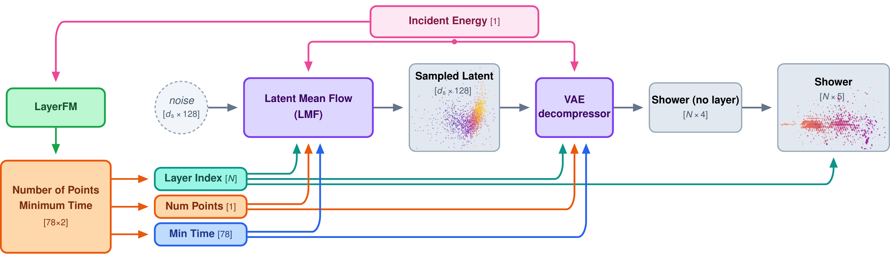

# CaloCHILL

**CaloCHILL** (Calorimeter Hits In Learned Latents): fast generation of hadronic showers,
with hit times, in a high-granularity calorimeter. Code for the paper
*Just CaloCHILL: fast hadronic shower generation in a learned latent space*.

- Paper: <https://arxiv.org/abs/2611.08606>
- Model weights: <https://huggingface.co/FLC-QU-hep/CaloCHILL>
- Dataset: <https://doi.org/10.25592/uhhfdm.22077>
- LayerFM, per-layer numbers of points and earliest hit times: code <https://github.com/FLC-QU-hep/LayerFM>,
  weights <https://huggingface.co/FLC-QU-hep/LayerFM>

$\pi^+$ showers between 10 and 90 GeV in the ILD calorimeter (ECal and HCal, 78 layers)
are generated as point clouds in three stages:

1. **LayerFM** generates the number of points and the earliest hit time in each layer from
   the incident energy (flow matching, distilled to a single step; separate repository).
2. The **latent mean flow (LMF)** generates the latent representation of the shower,
   $d_s$ vectors of dimension 128, in a single network evaluation.
3. The **VAE decompressor** expands the latent into the point cloud, with position, energy
   and time for every point.



The VAE compressor is only needed for training and for the reconstruction studies.
Generated point clouds are projected onto the readout cells before they are compared with
Geant4.

The code uses the names of the paper: `--net VAE` (`configs/configs_VAE.yaml`, class `VAE`)
trains the VAE compressor and decompressor, `--net LMF` (`configs/configs_LMF.yaml`, class
`LMF`) the latent mean flow. The CaloHadronic model the paper compares against is run with its
own code, <https://github.com/FLC-QU-hep/CaloHadronic>.

## Installation

Python 3.11 and a CUDA GPU (flex attention needs PyTorch >= 2.10; the paper used 2.13).

```bash
git clone https://github.com/FLC-QU-hep/CaloCHILL.git
git clone https://github.com/FLC-QU-hep/LayerFM.git      # next to CaloCHILL
cd CaloCHILL
python3.11 -m venv .venv && source .venv/bin/activate
pip install -r requirements.txt
pip install --no-deps "k-diffusion @ git+https://github.com/crowsonkb/k-diffusion.git@4601bf085320592473f681a62808ed873d17fad5" dctorch==0.1.2
```

All commands below are run from the repository root; the scripts use paths relative to it.

LayerFM (numbers of points and earliest hit times per layer) is imported from the LayerFM clone, by default `../LayerFM`, and its
distilled checkpoint `results/20260619_124529_LayerFM_PandT_/checkpoint_distill.pt` inside
it (download the folder from the LayerFM Hugging Face page; it includes the fitted input
transformations, `transforms.pt`, so the LayerFM training data is not needed). Other
locations are set with `LAYERFM_ROOT` and `LAYERFM_CKPT`.

Training logs to [Comet](https://www.comet.com) when `log_comet: true` in the model config;
the API key is read from `COMET_API_KEY` or from comet's own configuration.

## Data

Geant4 $\pi^+$ showers with incident energies from 10 to 90 GeV, on the virtual grid nine
times finer than the readout (HGx9 point clouds, with hit times), 100 files of which 96 are
used for training. The dataset is at <https://doi.org/10.25592/uhhfdm.22077>; CaloCHILL is
trained on the `CaloCHILL_pions_10-90GeV_NNN.hdf5` files. Put them in a folder of their own and
point `CALOCHILL_DATASET` to them (see [Environment variables](#environment-variables)).

The layer positions used for the projection onto the readout cells are in
`files/geometry/layer_*_pos_ecal+hcal.npy`.

## Environment variables

All paths in the code are relative to the repository root; the locations that depend on your
system are set with environment variables.

| Variable | Default | Used for |
|---|---|---|
| `CALOCHILL_DATASET` | `./dataset/hdf5_HGx9new/…_{}.slcio.root_with_time.hdf5` | file pattern of the training data; `{}` (or `{:03d}`) is replaced by the file number 1–100 |
| `LAYERFM_ROOT` | `../LayerFM` | clone of the LayerFM repository |
| `LAYERFM_CKPT` | `results/20260619_124529_LayerFM_PandT_/checkpoint_distill.pt` inside `LAYERFM_ROOT` | distilled LayerFM checkpoint |
| `CONFIG_MODEL` | `configs/configs_<net>.yaml` | model config used by `scripts/training.py` |
| `COMET_API_KEY` | comet's own configuration | Comet logging, only with `log_comet: true` |
| `MASTER_ADDR`, `MASTER_PORT` | `localhost` and a free port | only for runs on several nodes |
| `LIBRARY_PATH` | `/usr/local/cuda/lib64` if unset | CUDA libraries for the KeOps and Triton builds |

For example, with the dataset from FDR in `/path/to/data`:

```bash
export CALOCHILL_DATASET=/path/to/data/CaloCHILL_pions_10-90GeV_{:03d}.hdf5
export LAYERFM_ROOT=/path/to/LayerFM
```

## Model weights

Download the folders of <https://huggingface.co/FLC-QU-hep/CaloCHILL> into `logs/`:

```bash
hf download FLC-QU-hep/CaloCHILL --include "logs/*" --local-dir .   # creates logs/<model folder>/
```

Every folder holds the checkpoint and the configs it was trained with; the list of models,
with the VAE each LMF uses, is on the Hugging Face page. The LMF folders point to their VAE through `model.vae_path` in `configs_LMF.yaml`. For retraining,
`configs/` holds the configs of the large LMF at $d_s = 256$ and its VAE; the values of the
other models are given in the comments there.

The large LMF at $d_s = 256$ is the default of the generation and timing scripts.

## Energy calibration

Every generated sample is corrected by an energy-dependent factor
$f(E) = \sum_k a_k E^{p_k}$ applied to the incident energy that conditions the LMF
(appendix "Energy calibration" of the paper). The coefficients used in the paper, fitted per model
over the full range of 10–90 GeV and used for every sample (full range and single energies),
are listed on the Hugging Face page and passed as
`--energy_calibration_factor a0 a1 a2 --energy_calibration_powers p0 p1 p2`.

To calibrate a new model, generate an uncalibrated full-range sample and fit the factor:

```bash
python scripts/evaluation/generate.py --lmf_dir <run>/ --inc_en 0 --n_showers 10000 --num_steps 1
python scripts/evaluation/fit_poly_calib.py files/generated_showers/<run>_1/showers_0GeV_10000.hdf5   # prints a0 a1 a2
```

## Training

Both models are trained by `scripts/training.py`. The data config is
`configs/configs_data.yaml`; the model config is `configs/configs_VAE.yaml` (VAE) or
`configs/configs_LMF.yaml` (LMF), or the
file given in `CONFIG_MODEL`. Runs are written to `logs/<run>/` (checkpoints and a copy of
the configs).

```bash
# VAE (compressor and decompressor)
CONFIG_MODEL=configs/configs_VAE.yaml \
    torchrun --standalone --nproc_per_node <GPUs> scripts/training.py --dataset pions --net VAE

# LMF on a trained VAE (model.vae_path = <VAE run folder>/ckpt_best.pt)
CONFIG_MODEL=configs/configs_LMF.yaml \
    torchrun --standalone --nproc_per_node <GPUs> scripts/training.py --dataset pions --net LMF
```

`--test` runs a single iteration on a small subset, without Comet, as a check before a
long run.

`--net CaloHadronic` (`configs/configs_CaloHadronic.yaml`, `scripts/models/CaloHadronic_legacy.py`)
is the CaloHadronic point-cloud EDM with hit times of October 2025, trained directly on the hits
without a latent space. Network, loss, optimiser step and Heun sampling are identical to the
original run (its checkpoints load with `strict=True`). The original data loader did not sort the
showers by number of hits and cropped every shower in a batch to the length of the last one,
dropping the earliest hits of about half of the showers; the loader here keeps all hits.

```bash
CONFIG_MODEL=configs/configs_CaloHadronic.yaml \
    torchrun --standalone --nproc_per_node <GPUs> scripts/training.py --dataset pions --net CaloHadronic
```

## Generation

```bash
python scripts/evaluation/generate.py \
    --lmf_dir <LMF folder>/ --inc_en 50 --fixed_energy --n_showers 10000 --num_steps 1 \
    --energy_calibration_factor 1.05027 -0.000404716 3.7038e-06 --energy_calibration_powers 0 1 2
```

On one GPU the scripts run with plain `python`; `torchrun` is only needed for several GPUs.
`--inc_en 0` takes the incident energies of dataset showers, uniform between 10 and 90 GeV;
without `--fixed_energy`, `--inc_en E` takes those of the dataset showers within ±0.1 GeV of E.
By default a sample of Geant4 showers from the dataset is also compressed and decompressed by
the VAE (the reconstruction). With `--no_reco` the dataset is not read at all: the incident
energies are exactly `--inc_en` with `--fixed_energy`, otherwise uniform in the energy range,
so only the weights and LayerFM are needed. `--g4_conditioning --real_file <hdf5>` conditions
on the per-layer numbers of points and earliest times of the Geant4 showers in that file
instead of LayerFM.

The showers are written to
`files/generated_showers/<LMF folder>_<num_steps>/showers_<E>GeV_<N>[_calib<f>].hdf5`:

| Key | Shape | Content |
|---|---|---|
| `gen_events` | (N, P, 5) | generated points, `[x, z, layer, energy, time]` |
| `gen_energy` | (N, 1) | incident energy [GeV] |
| `reco_events` | (N, P', 5) | Geant4 showers after the VAE (not written with `--no_reco`) |
| `reco_energy` | (N, 1) | their incident energies [GeV] |

`x` and `z` are the transverse coordinates in mm, `layer` the layer index (0–29 ECal, 30–77
HCal), `energy` the deposited energy in MeV and `time` the hit time in ns (at most 200 ns);
the model without time has 4 columns. The points are on the virtual grid of the training data
and each shower is padded with zero rows to the largest one in the file; `occ-scale.py`
projects them onto the readout cells.

## Evaluation and paper figures

1. **Projection onto the readout cells and observables**: `scripts/evaluation/occ-scale.py`,
   cached in `files/projected_array/<folder>/`. Geant4 is
   projected in the same way into `files/projected_array/Geant4/`. The time floor of the
   paper uses `files/projected_array/Geant4/time_floor.npy`.
2. **Comparison and distances** (normalised Wasserstein distance and Jensen–Shannon
   divergence, with the Geant4 floor): `scripts/evaluation/compare_ds_occscale.py`.

| Paper | Script |
|---|---|
| Fig. 3, attention masks | `plot_flex_attn_latent.py` |
| Figs. 4, 18, 19, event displays | `event_display.py` |
| Fig. 5, Table I, latent sizes; Fig. 11, Table VIII, VAE reconstruction | `compare_ds_occscale.py`, `paper_outputs.py fig-ds-profiles`, `paper_outputs.py table-ds-metrics` |
| Figs. 6, 14, Tables II, IX, comparison at 20, 50, 80 GeV | `plot_three_energies.py --per-energy`, `paper_outputs.py table-three-energies` |
| Fig. 7, Table XI, generation time | `timing.py`, `plot_timing_models.py --allshowers-csv`, `paper_outputs.py table-timing` |
| Fig. 8, accuracy against time | `plot_time_vs_quality.py` |
| Figs. 9, 10, latent space (LDA) | `latent_analysis.py encode`, `latent_analysis.py lda-ds-grid` |
| Fig. 12, time of the first hit | `time_response.py first_hit_100k`, `time_response.py plot_paper` |
| Fig. 15, linearity and resolution | `time_response.py linearity` |
| Fig. 13, energy calibration | `fit_poly_calib.py`, `plot_energy_calibration_fit.py` |
| Table X, classifier | `highLevel_classifier.py --moments --no-nhits --hidden 2048` |
| Figs. 16, 17, time against shower size | `timing.py --toy-points`, `plot_timing_models.py`, `plot_pipeline_breakdown.py` |

The scripts are in `scripts/evaluation/` unless a path is given. The comparisons with
AllShowers and CaloHadronic read samples generated with those models' own code from the
folders given in the scripts. CaloHadronic samples in its own format are converted with
`convert_calohadronic_legacy.py` and projected with `occ-scale.py`.

## Repository layout

```
configs/                 data, VAE and LMF configs (paper variants in comments)
scripts/training.py      training of all models
scripts/models/          LMF (CaloHadronic.py), latent network, VAE/
scripts/utils/           data loading, sparse attention masks, generation, projection, plotting
scripts/evaluation/      generation, projection, distances, timing, paper figures and tables
files/                   layer geometry, per-layer minimum hit times, Geant4 time floor, timing inputs
tests/                   CPU unit tests on synthetic showers (dataset, VAE, LMF, CaloHadronic)
```

## Development

```bash
python -m unittest discover -s tests -p '*_test.py'   # CPU, about a minute
pip install pre-commit && pre-commit install          # ruff, ruff-format, yamlfmt before every commit
```

## Citation

```bibtex
@article{Day-Hall:2026bmg,
    author = {Day-Hall, Henry and Gaede, Frank and Kasieczka, Gregor and Kr{\"u}ger, Katja and Mozzanica, Martina},
    title = "{Just CaloCHILL: fast hadronic shower generation in a learned latent space}",
    eprint = "2611.08606",
    archivePrefix = "arXiv",
    primaryClass = "physics.ins-det",
    month = "11",
    year = "2026"
}
```

## License

MIT, see `LICENSE`.
